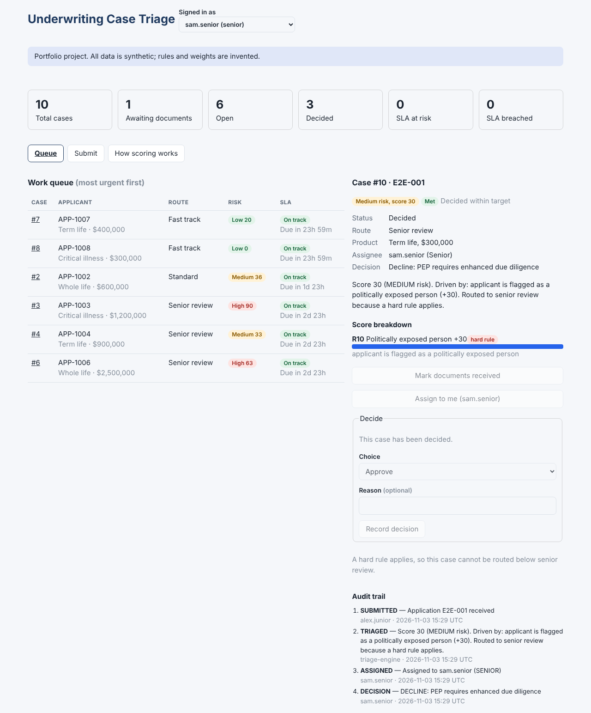

# Underwriting Case Triage

A small case-management system that scores life and health insurance applications, routes each to
the right review queue, tracks service-level (SLA) deadlines and keeps an audit trail of every action.
**All data is synthetic. Rules and weights are invented for this project and are not real underwriting
guidelines or any company's rules.**



## What it does
- **Explainable scoring:** 12 rules each add points with a plain-language reason. Nothing is a black box.
- **Hard rules:** politically exposed person, high-risk country, or very large sum always means senior review, whatever the score.
- **Routing and SLA:** Fast track 24h, Standard 48h, Senior review 72h. The clock starts when documents are complete and a case is "at risk" with 25% of the window left.
- **Controls:** senior-only cases need a senior underwriter; only the assignee can decide; declines, counter-offers and overrides need a written reason; hard-rule cases cannot be overridden downward.
- **Audit trail:** append-only record of who did what and when.

## Design
- `src/main/java/triage/` is framework-free Java 21: `model` (records/enums), `rules` (pure functions), `service` (commands with state checks, one lock), `repository` (interface + in-memory), `web` (thin JDK HTTP adapter).
- `spring-api/` re-exposes the same service through `@RestController`s (see status below).
- `frontend/` is React 19, bundled with esbuild. Pure UI rules live in `src/logic.js` so they can be unit tested.
- The clock is injected, so SLA behaviour is tested without sleeping.

## Status: what is verified
| Part | Status |
|---|---|
| Java core + JDK HTTP API | 70 JUnit tests passing; also checked by deliberately breaking 21 behaviours and confirming the tests fail |
| React dashboard | 24 unit/component tests; browser run against the live API |
| Spring Boot layer, Dockerfiles, compose, pom.xml | **Written but not yet compiled or run by the author. See `docs/SPRING_BOOT_GUIDE.md`** |

## Run it (without Spring)
```
mvn test
java -cp target/classes:<gson jar> triage.Main     # API on :8080, demo data loaded
cd frontend && npm install && npm run dev          # http://localhost:5173
```
Or with Spring Boot: see the guide.

## API
`GET /health /rules /queue /reports/summary /cases /cases/{id}` and
`POST /cases /cases/{id}/documents|assign|decision|override`. Errors: 400 invalid input, 404 not found, 409 not allowed in the current state.

## Limitations
In-memory storage (data resets on restart), no real authentication (the "signed in as" switch is a demo), invented weights, single instance. A natural next step is PostgreSQL behind `CaseRepository`.
